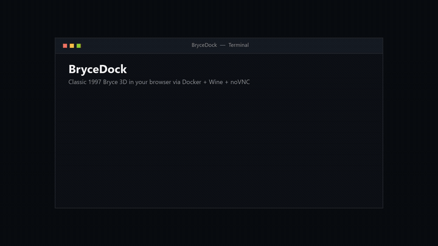

<div align="center">

# BryceDock

**Run classic MetaCreations Bryce 3D (1997) in any web browser via Docker, 32-bit Wine, and noVNC.**


-4c1)
-722F37)
-1f2937)

<br />


<sub><i>Classic Bryce 3D raytraced artwork (render by j0rnsha)</i></sub>

</div>

---

## Overview

**BryceDock** containerizes **Bryce 3D (1997)** into a self-contained, browser-accessible workspace with zero host X11/Wayland setup and no GPU passthrough required.

- **Browser-based GUI:** Open `http://localhost:6080` on Linux, Windows, or macOS — no native VNC viewer or display server needed.
- **No 16-bit installer issues:** Compiles [`unshieldv3`](https://github.com/wfr/unshieldv3) natively on Linux to unpack Bryce 3D's InstallShield 3 `data.1` archive directly from `Bryce3DCD.iso`.
- **Reliable preset libraries & shortcuts:** Includes a lightweight server-side RFB proxy (`rfb_click_proxy.py`) so Bryce 3D's **Objects**, **Materials**, and **Sky&Fog** preset popups stay open on normal mouse clicks/touchpad taps, and keyboard shortcuts like **`Ctrl+Z`** (plus **`⌘Z`** on macOS and non-Latin keyboard layouts) work reliably even after hovering the auto-hide menu bar.
- **Native ARM64 speed on Apple Silicon:** Multi-arch Docker build automatically uses **Hangover Wine (WoW64) + FEX** (`FEX_X87REDUCEDPRECISION=1`) on `arm64` instead of slow QEMU emulation — delivering ~15× faster raytrace renders on M1–M4 Macs.
- **Direct file exchange:** Your saved scenes and renders appear directly in the `projects/` folder inside this repository (`BryceDock/projects/`).
- **Clean, redistributable image:** Neither `Bryce3DCD.iso` nor your serial number is baked into the Docker image.

---

## Demo

<div align="center">



<sub><i>Launching BryceDock with Docker Compose, applying Materials &amp; Sky&amp;Fog presets, and raytracing live in the browser</i></sub>

</div>

---

## Platform Support

| Platform | Architecture | Status | Notes |
| --- | --- | --- | --- |
| **Linux** | `x86_64` | Native speed | Docker Engine + Docker Compose plugin |
| **Windows 10 / 11** | `x86_64` | Native speed | Docker Desktop (WSL2 backend) or Docker Engine in WSL2 |
| **macOS (Intel)** | `x86_64` | Native speed | Docker Desktop, OrbStack, or Colima |
| **macOS (Apple Silicon)** | `arm64` | **Fast (Native ARM64 + FEX)** | Runs natively on `linux/arm64` via [Hangover Wine](https://github.com/AndreRH/hangover) + [FEX](https://github.com/FEX-Emu/FEX) (`FEX_X87REDUCEDPRECISION=1`) — no QEMU or Rosetta 2 needed! *(Existing Apple Silicon users upgrading from the older QEMU build: just run `git pull && docker compose up -d --build` — your registration and `projects/` stay intact.)* |
| **Linux (`arm64`)** | `arm64` | **Fast (Native ARM64 + FEX)** | Raspberry Pi 5, ARM64 servers/laptops, Windows-on-ARM (WSL2) |

> **Performance:** On `x86_64`, Wine executes 32-bit instructions natively on your CPU. On `arm64` (Apple Silicon M1–M4, ARM64 Linux), the entire Linux/X11/VNC/Wine stack runs natively on ARM64 and **FEX** JIT-translates Bryce 3D's 1997 x86/x87 math with reduced-precision x87 enabled (~15× faster renders than QEMU/Rosetta). *(If you're on Apple Silicon and prefer a standalone native macOS `.app` without Docker, check out [highda/bryce-macos-installer](https://github.com/highda/bryce-macos-installer), which pioneered this Hangover + FEX setup for Bryce 3D!)*

---

## Quick Start

### Prerequisites
- **Docker** and **Docker Compose** installed on your machine.
- Your own [copy](https://archive.org/details/Bryce3DCD) of **`Bryce3DCD.iso`** and a valid Bryce 3D [serial number](https://ia903107.us.archive.org/29/items/bryce4/install.txt).

<details>
<summary>Need to install Docker first? Click here for Windows, macOS, and Linux steps</summary>

- **Windows 10/11:** Install [Docker Desktop for Windows](https://www.docker.com/products/docker-desktop/) with the **WSL 2** backend enabled, start it, and verify `docker compose version` in PowerShell.
- **macOS:** Install [Docker Desktop for Mac](https://www.docker.com/products/docker-desktop/) (or OrbStack / Colima). Works natively on both Intel (`amd64`) and Apple Silicon (`arm64`) with no special settings required.
- **Linux (Ubuntu/Debian):**
  ```bash
  curl -fsSL https://get.docker.com | sh
  sudo usermod -aG docker "$USER"
  # Log out and back in, then verify:
  docker compose version
  ```

</details>

### 1. Clone the repository
```bash
git clone https://github.com/RaymonDev/BryceDock.git
cd BryceDock
```

### 2. Add `Bryce3DCD.iso`
Place your `Bryce3DCD.iso` file directly inside the root of this `BryceDock/` folder (next to `docker-compose.yml`).

*(Optional: to download the ISO automatically instead of storing it locally, remove the ISO mount line in `docker-compose.yml` and set `BRYCE_ISO_URL` in `.env`.)*

### 3. (Optional) Pre-configure first-run personalization
To skip Bryce 3D's first-launch serial prompt automatically, copy `.env.example` to `.env` and add your serial number:

```bash
# Linux / macOS
cp .env.example .env

# Windows PowerShell
Copy-Item .env.example .env
```

Edit `.env`:
```env
BRYCE_NAME=Bryce User
BRYCE_ORG=Studio
BRYCE_SERIAL=YOUR-SERIAL-HERE
```
*(If you skip this step, Bryce 3D will prompt you once inside the browser and persist your registration in the Docker volume. `.env` is ignored by both Git and Docker.)*

### 4. Build and launch
```bash
docker compose up -d --build
```

Wait ~15–20 seconds on first boot (you can monitor progress with `docker compose logs -f`), then open your browser to:

```text
http://localhost:6080
```

Press **`F11`** (or use the Fullscreen icon in the collapsible left noVNC sidebar) for edge-to-edge fullscreen.

---

## Saving, Exporting & Importing Files

All user files are shared through the **`projects/`** folder **inside this repository's root directory** (`BryceDock/projects/`, right next to `docker-compose.yml` — it is created automatically when you start the container, not elsewhere on your computer):

```text
BryceDock/
├── Bryce3DCD.iso        # Your original Bryce 3D CD image (ignored by Git/Docker)
├── .env                 # Optional local config/serial (ignored by Git/Docker)
├── projects/            # <-- YOUR SAVED SCENES, RENDERS & IMPORTS LIVE HERE
├── docker-compose.yml
├── Dockerfile
└── ...
```

Inside Bryce 3D, **Desktop**, **Documents**, **Pictures**, **Videos**, **Bryce3D → Projects**, and **My Computer → `E:`** all point directly to `BryceDock/projects/`:

| Location inside Bryce 3D | Location on your PC | Purpose |
| --- | --- | --- |
| **Documents**, **Desktop**, **Bryce3D → Projects**, or **`E:`** | `BryceDock/projects/` | Save `.br3` scenes, export renders/videos, and import your own models/textures |
| **Bryce3D → CD_Content** or **My Computer → `D:`** | Extracted from `Bryce3DCD.iso` | Original 1997 sample scenes, model/texture/sky/terrain libraries, and User Guide PDFs |

### How to save & export
Hover your mouse at the **very top edge** of the Bryce 3D window to reveal the `File | Edit | Objects | Help` menu bar:

1. **Save a scene (`.br3`):** **File → Save As...** (`Ctrl+S`) → choose **Documents** or **Desktop** → Save. The file appears immediately in `BryceDock/projects/`.
2. **Export a rendered image (`.bmp` / `.psd`):** Render your scene (**`Ctrl+R`** or click the large Render sphere) → **File → Export Image...** → save to **Documents** or **Desktop**.
3. **Render high-resolution stills to disk:** **File → Render to Disk...** → set resolution → save to **Documents** or **Desktop**.
4. **Export an animation (`.avi` or BMP sequence):** **File → Animation Setup...** (`Ctrl+Shift+N`) → **File → Render Animation...** (`Ctrl+Shift+R`) → save to **Documents** or **Desktop**.
5. **Import models or textures from your PC:** Drop `.obj`, `.3ds`, `.dxf`, or image files into `BryceDock/projects/`, then open them in Bryce 3D via **File → Import Object...** or **File → Open Image...** from **Documents** or **Desktop**.

> **Tip:** Right-click the dark desktop background at any time to open the window-manager menu (**Launch Bryce 3D**, **Wine Configuration**, **Terminal**).

---

## Common Commands

Run all commands from inside the `BryceDock/` repository folder:

```bash
# Build and start in background
docker compose up -d --build

# Follow startup logs (Ctrl+C to exit logs)
docker compose logs -f

# Check status and health
docker compose ps

# Stop / start (keeps installation and settings)
docker compose stop
docker compose start

# Restart Bryce 3D
docker compose restart

# Apply changes to .env or docker-compose.yml
docker compose up -d --force-recreate

# Clean reset (re-extracts ISO & resets Wine prefix; keeps BryceDock/projects/)
docker compose down -v && docker compose up -d

# Complete uninstall (removes container, volume, and local image; keeps BryceDock/projects/)
docker compose down -v --rmi local
```

<details>
<summary>Running without Docker Compose (plain <code>docker build</code> / <code>docker run</code>)</summary>

**Linux / macOS:**
```bash
docker build -t brycedock .

docker run -d --name brycedock \
  -p 6080:6080 \
  --shm-size=512m \
  -e RESOLUTION=640x480 \
  -e BRYCE_NAME="Bryce User" \
  -e BRYCE_ORG="Studio" \
  -e BRYCE_SERIAL="YOUR-SERIAL-HERE" \
  -v "$(pwd)/Bryce3DCD.iso:/iso/Bryce3DCD.iso:ro" \
  -v "$(pwd)/projects:/workspace" \
  -v brycedock_data:/data \
  brycedock
```

**Windows (PowerShell):**
```powershell
docker build -t brycedock .

docker run -d --name brycedock `
  -p 6080:6080 `
  --shm-size=512m `
  -e RESOLUTION=640x480 `
  -e BRYCE_NAME="Bryce User" `
  -e BRYCE_ORG="Studio" `
  -e BRYCE_SERIAL="YOUR-SERIAL-HERE" `
  -v "${PWD}\Bryce3DCD.iso:/iso/Bryce3DCD.iso:ro" `
  -v "${PWD}\projects:/workspace" `
  -v brycedock_data:/data `
  brycedock
```

</details>

---

## Configuration

Set any of these variables in `.env` or under `environment:` in `docker-compose.yml`:

| Variable | Default | Description |
| --- | --- | --- |
| `RESOLUTION` | `640x480` | Virtual X11 display size. `640x480` matches Bryce 3D's native 1997 layout and scales cleanly via noVNC; increase to `800x600` or `1024x768` if you enlarge the document via **File → Document Setup** |
| `BRYCE_NAME` | `Bryce User` | Name used for automatic first-run personalization |
| `BRYCE_ORG` | `Studio` | Organization used for automatic first-run personalization |
| `BRYCE_SERIAL` | *(empty)* | Optional Bryce 3D serial number (kept in `.env`, never baked into the image) |
| `VNC_PASSWORD` | *(empty)* | Optional password to protect access on port `6080` / `5900` |
| `BRYCE_ISO_URL` | *(empty)* | Optional direct URL to download `Bryce3DCD.iso` on first boot if not mounted locally |

---

## Architecture

```text
Browser (http://localhost:6080)
  └── noVNC + websockify (:6080)
        └── rfb_click_proxy.py (127.0.0.1:5901)  ← preset popup clicks, focus recovery, Cmd+Z / non-Latin Ctrl+Z
              └── TigerVNC Xvnc (:5900 / X11 :0) + Openbox
                    └── Wine 32-bit (amd64) / Hangover Wine WoW64 + FEX (arm64)
                          └── Bryce 3D.exe (unpacked on first boot via bsdtar + unshieldv3)
```

- **InstallShield 3 extraction:** `Dockerfile` compiles `unshieldv3` natively in a builder stage so `entrypoint.sh` extracts `data.1` and the CD asset libraries cleanly without running the 16-bit `SETUP.EXE`.
- **Multi-arch runtime:** `Dockerfile` automatically selects `runtime-amd64` (native 32-bit Wine on x86_64) or `runtime-arm64` (native ARM64 [Hangover Wine](https://github.com/AndreRH/hangover) + [FEX](https://github.com/FEX-Emu/FEX) with `FEX_X87REDUCEDPRECISION=1`).
- **Workspace persistence:** The extracted application, CD libraries, and Wine prefix persist in the `bryce3d_data` Docker volume; your scenes and exports are bind-mounted directly to `BryceDock/projects/`.

---

## Troubleshooting

- **Port `6080` already in use:** Change `"6080:6080"` to `"6081:6080"` in `docker-compose.yml`, run `docker compose up -d`, and open `http://localhost:6081`.
- **Cannot save into `BryceDock/projects/` on Linux:** The container runs as UID `1000`. If Docker created `projects/` as `root`, run `sudo chown -R 1000:1000 ./projects`.
- **Undo (`Ctrl+Z` / `⌘Z`):** Bryce 3D (1997) supports a **single-level Undo/Redo toggle** — pressing `Ctrl+Z` (or `⌘Z` on macOS) once undoes your last action, and pressing it a second time redoes it.
- **Closed Bryce 3D accidentally:** Right-click the desktop background and select **Launch Bryce 3D**.

---

## Credits

- **[highda/bryce-macos-installer](https://github.com/highda/bryce-macos-installer)** — pioneered running Bryce 3D natively on Apple Silicon via Hangover Wine + FEX (`FEX_X87REDUCEDPRECISION=1`), achieving ~15× faster renders than QEMU/Rosetta.
- **[Hangover](https://github.com/AndreRH/hangover)** & **[FEX](https://github.com/FEX-Emu/FEX)** — ARM64 WoW64 Wine and x86/x87 JIT translation.
- **[unshieldv3](https://github.com/wfr/unshieldv3)** — native Linux extractor for InstallShield 3 archives.

---

## Legal Notice

Bryce 3D is copyright MetaCreations Corp. / DAZ 3D. This repository distributes only Docker build recipes and helper scripts — no Bryce 3D binaries, CD assets, or license keys are included. You must provide your own legal copy of `Bryce3DCD.iso` and serial number.
